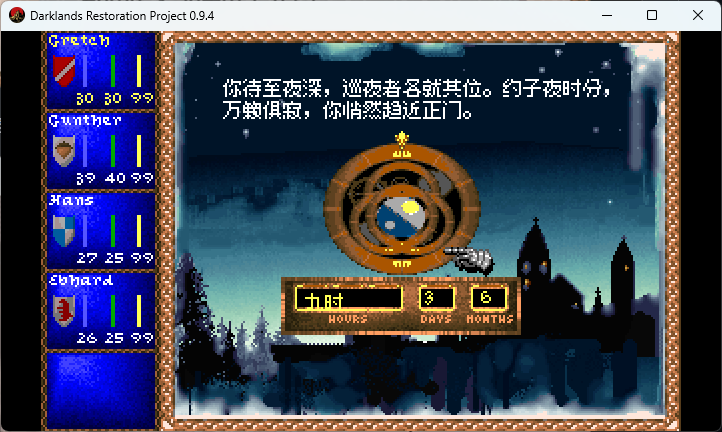
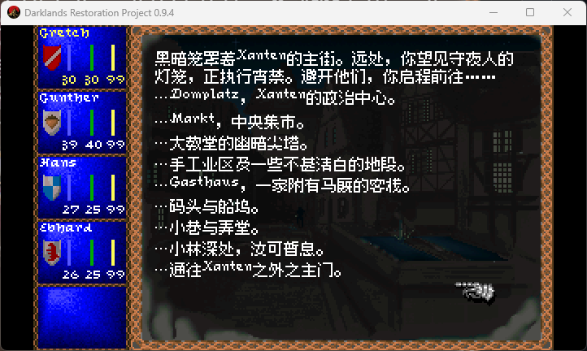
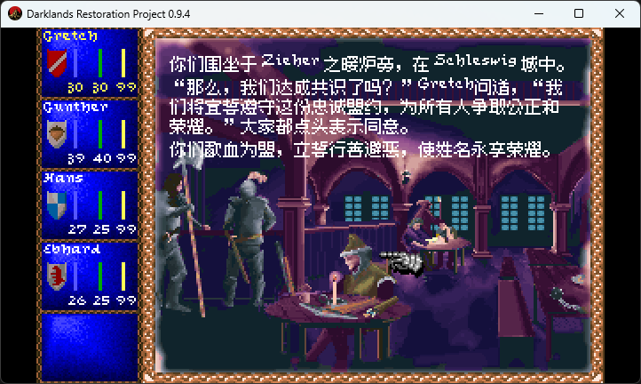
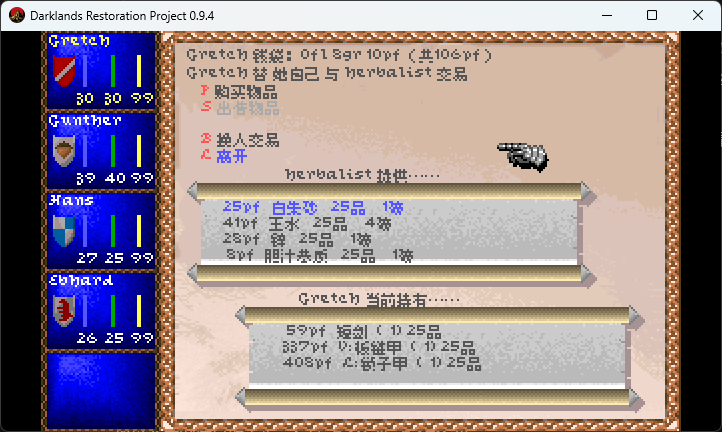
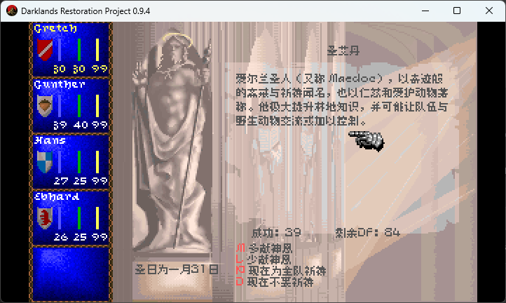
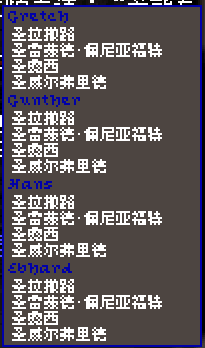

# Darklands Restoration Project

*Darklands* — MicroProse's 1992 role-playing game of 15th-century Germany, its saints, alchemy,
witches and robber knights — rebuilt to run on today's Windows, without DOSBox, and to play exactly
like the original.

<p>


</p>

<sub>Screenshots of version 0.9.0 (`docs/screenshots/0.9.0`): the start screen, a Gasthaus in Strassburg, the
world map, a battle, a character sheet, a night's camp. More: character creation and an inn's choices.</sub>

This is not a remake and not an emulator. Every rule of the original — combat, prices, saints,
alchemy, the cards of every city and encounter, the generators of castles, mines and battlefields —
has been rewritten in C# from the original program, and checked against that program running
function by function. The screens, the music and the sound are the original's, drawn and played from
your own copy of the game.

**You need your own copy of Darklands** (version 483.07, for example the GOG release). Nothing from
the game is included here: the program reads your installation.

## Getting started

1. Get a release (`DarklandsRP.exe` with `SDL2.dll`, `libmt32emu.dll`, `RELEASE_NOTES.md` and an empty `MT32_ROMS`
   folder) and unpack it into a folder of its own.
2. Start `DarklandsRP.exe`. On the first run it opens the launcher, a settings screen before the game: it has found
   your Darklands by itself (GOG, Steam, or a folder next to it), and you can check the game folder, the window, the
   sound card and the Roland ROM folder, and try the sound, then press **Play**. The choices go into
   `darklands.settings.json`, next to the program. Later starts go straight to the game; hold **Shift** while starting
   it (or start it with `--setup`) to see the launcher again. If the game can't be found or can't start, the launcher
   comes up by itself and says why.
3. Play. It starts like the original: the banner, the opening, then the start screen with Quickstart,
   a new world or a saved game.

Saved games go to the game folder's `SAVES`, the same place the original uses, so the two share their
saves both ways. If that folder can't be written (a game under Program Files, as GOG Galaxy installs
it), the saves go to `%APPDATA%\DarklandsRestoration\SAVES` instead and a line at start-up says so; copy
your existing saves (`DKSAVEn.SAV` and `.BSV`) there to keep playing them, or set `"savesFolder"` to
another folder you can write to.

## Playing

The keys and the mouse are the original's: the menu bar with the right button or F10, F1–F5 for the
character sheets, F6 for the party, Ctrl-F1–F5 to choose the leader, Alt-S save, Alt-L load, Alt-P pause,
Alt-O the marching order, Alt-D difficulty, Alt-M music, Alt-F sound effects, Alt-Q quit. Two keys are
this program's own: **F12** saves a screenshot, and **F11** opens a developer console over the game
(`help` lists its commands: time, money, attributes, saints, items...).

## Sound and music

The game's own sound drivers play, as on a 1992 PC: by default the card set up in your copy's
`CONFIG.DRK`, usually a Roland MT-32 for music with a Sound Blaster for speech. For the MT-32 put your
MT-32 or CM-32L ROM files in the `MT32_ROMS` folder that comes with the program, or choose their folder in the
launcher (it shows whether the ROMs of the chosen module are there). Without them the Sound Blaster Pro's FM music
plays instead, and the program says so. The launcher's sound card (`"card"` in the settings) chooses another card:
AdLib, Sound Blaster, Sound Blaster Pro 2, MT-32 or CM-32L.

## Settings

`darklands.settings.json`, next to the program, is commented and shows every default. The ones you may
want:

| Setting | What |
|---|---|
| `gameFolder`, `savesFolder` | where your Darklands is; where the saves go |
| `display.scale`, `display.resolution`, `display.fullscreen` | a bigger window (`2` = 1440x800), any size (`"1600x1000"`), full screen |
| `sound.card`, `sound.mt32Roms` | the sound card; where the MT-32 ROMs are |
| `startup.banner`, `startup.intro` | skip the banner or the opening |

Everything else is in `docs/SETTINGS.md`, which also lists the command-line forms (`--fullscreen`,
`--scale 2`, `--no-intro` and so on).

**新玩家入门**：`docs/GAME_GUIDE_ZH.md` 是一份中文游戏指南，含属性、技能、136 位圣徒、
18 件圣物、330 处地点的对照表（数据逐条提取自游戏本体）。

## Status: version 0.9.4

The whole game plays: character creation, cities and their streets, inns and shops, guilds, banks and
churches, the world map and its encounters, battles, camping, saints and alchemy, saving and loading.
What is knowingly different from the original, and which of the original's bugs are kept (deliberately:
they are part of Darklands), is listed in `docs/faithfulness`. Things not done yet are listed where they
belong (battles: `docs/BATTLES.md`).

Version 1.0 will come when the remaining faithfulness checks are finished.

## License

The Darklands Restoration Project is free software: you can redistribute it and/or modify it under the
terms of the GNU General Public License as published by the Free Software Foundation, either version 3
of the License, or (at your option) any later version. See `LICENSE`.

This covers the project's own code only. *Darklands* itself (© 1992 MicroProse) is not part of it and
not licensed by it; you need your own copy of the game. Third-party components keep their own licences
(see `THIRD_PARTY_NOTICES.md`).

## 汉化（Simplified Chinese）

本 fork 在 Restoration Project 之上加入**简体中文**。上游没有国际化支持，也没有 mod / 插件接口，
所以 CJK 渲染路径是**源码树的一部分**，而不是外挂的插件。

> ⚠️ **实验性构建（experimental）**：卡片文本的可打印 run 已逐条进入翻译表（7,729 / 7,729，按静态扫描统计；译文里另有 86 条界面模板与变量条目），
> 译文为**人工翻译**（机器翻译已弃用）。但卡片换行、选项列表、谜题旋钮、`$he/$his` 代词替换等**尚未全面实测**，
> 覆盖率数字也只反映静态文本，不代表运行时表现。
> 欢迎试用与反馈，但请勿视作成品。详见[已知问题](#已知问题)。

---

### 现状

| 项目 | 状态 |
| --- | --- |
| 卡片 run 覆盖率 | **7,729 / 7,729**（按出现次数的静态扫描，非运行时验证） |
| 表条目 | **8,771 条**（8,685 条译文 + 86 条界面模板/变量条目 + 66 条恒等占位，另有 4 行未计） |
| 表文件 | `translations_zh.tsv`，8,780 行 / 1,792,675 字节 |
| 卡片字体 | Fusion Pixel **10px** 等宽（卡片正文、选项行） |
| 界面字体 | Fusion Pixel **8px** 等宽（商店、祈祷等 UI 行） |
| 渲染方式 | StbTrueTypeSharp → 320×200 索引画布（二值，无 alpha 混合） |
| 译文来源 | **人工翻译**（Qwen-MT 已弃用） |
| 覆盖的 UI | 卡片窗口、侧窗、屏幕页、队伍面板、菜单栏、商店 / 交易 / 拾取、祈祷 |
| 未验证 | 选项列表、谜题旋钮、代词替换 |
| 未翻译 | 图片内嵌文字（需 HD 包）、部分代码内硬编码字符串 |

---

### 效果展示

以下截图来自 v0.9.4 的 win-x64 单文件构建（`--scale` 窗口）。

**卡片正文** —— Fusion Pixel 10px 等宽。折行、避头标点与 `$变量` 展开都有专门处理；
底部时钟条的 `Prime` / `Hours` / `Days` 等仍是原版英文（属图片内嵌文字）。



**城镇选项** —— 卡片窗口内的选项列表，中文与原版混排的 `……` 前缀。



**室内对话** —— 酒馆内的叙述与人物对话（含 `$NamedOneName` 等变量展开）。



**商店界面** —— 商品名、品质、价格、重量、数量均为中文；行结构由模板 + 参数渲染。



**祈祷界面** —— 圣徒名、圣徒描述、圣日、状态栏均走翻译表。



**队伍面板** —— 队员名与所属圣徒名（竖版，原始比例较小）。



---

### 本轮进展

- **66 条恒等占位修复**：早期的「结构性 run 恒等销账」机制误把 66 条真卡片文本（叙述 / 对话 /
  选项整句）写成 `英文→英文` 恒等条目，于是它们永远命中不了翻译表、游戏里一直是英文。
  这批已逐条人工译出。
- **圣徒名与描述**：136 位圣徒的全名 / 短名与描述。
- **商店 / 交易 / 拾取界面**：整行原来是一个 run，而价格、品质、重量、数量是运行时数字，
  整行永远不可能命中静态翻译表。改为**模板 + 参数**（`TranslationTable.Line`），
  行被拆成可译片段。
- **祈祷界面**：状态、菜单、圣日、圣徒描述均走查表。
- **卡片折行修复**（影响中文卡片文本的折行）：每行吞 1 个字符、中文行退到行内最后一个空格断行、
  行首出现收尾标点。
- **10px 卡片字体**：卡片正文与选项行改用 Fusion Pixel 10px 等宽（原为 WenQuanYi Bitmap Song 12px）。
  WQY 的最小面是 12px，字腔偏大、会把选项行挤出卡片文本框；Fusion Pixel 有 10px 面，
  `unitsPerEm == ascent − descent == 1000`，em=10 正好落在整数像素网格上。随附的 WQY 许可文件已删除。

---

### 安装

需要本 fork 的构建产物（`DarklandsRP.exe`）加你自己拥有的 *Darklands* 游戏数据（例如 GOG 版）。
**仓库不含任何原版游戏文件。**

1. 按[构建](#构建)一节编译本 fork。
2. 启动 `DarklandsRP.exe`，指向你的游戏目录。
3. **免构建调试**：设置环境变量即可换表，无需重新编译（改表后重启游戏即可）：

   ```
   DARKLANDS_TRANSLATIONS=<path-to>\translations.tsv
   ```

   字体同理：卡片字体 `DARKLANDS_CHINESE_FONT`（`local/paths.json` 的 `chinesefont` 键），
   界面 8px 字体 `DARKLANDS_UI_CHINESE_FONT`（`uichinesefont` 键）。

---

### 构建

```
dotnet build src/Darklands.Host.Sdl/Darklands.Host.Sdl.csproj -c Release
```

需要 .NET 10 SDK。中文路径不引入额外依赖（`StbTrueTypeSharp` 是上游已有的 NuGet 包）。

单文件发布（自带 .NET 运行时，目标机器无需安装 .NET）：

```
dotnet publish src/Darklands.Host.Sdl/Darklands.Host.Sdl.csproj -c Release -r win-x64 --self-contained true -p:PublishSingleFile=true -o artifacts/publish-win-x64
```

---

### 工作原理

* **接管点**：`TextDecoder.Decode` 与 `TextPainter`。ASCII（`< 0x80`）继续走原版位图字体，
  保持原版观感；`≥ 0x80` 且超出 Latin-1 的字符交给 `CjkFont`。
* **翻译粒度**：卡片文本中连续的 `0x20–0x7F` 字节段（称为一个 run）作为查表 key。
  控制码（`0x01–0x1F`）与颜色码（`0x80–0xFF`）是分隔符，**不作为翻译 key**。
* **表加载顺序**：`DARKLANDS_TRANSLATIONS` 环境变量 → `local/paths.json` 的 `translations` 键 →
  程序集内嵌资源。
* **卡片文本**在 `TextVariables.Expand` **之前**翻译（`CardScreen.cs:232`），
  因此译文里的 `$PlaceName`、`$Number1` 等占位符仍会被游戏替换。
* **字形**：`CjkFont` 用 StbTrueTypeSharp 一次性栅格化并按码位缓存。Fusion Pixel 是像素网格字体
  （`unitsPerEm = ascent − descent`：10px 面为 1000，8px 面为 800），必须按其原生 em 栅格化
  （卡片 **10px**、UI **8px**），否则覆盖度不再是二值，阈值会吃掉笔画。
  `GameUi.cs` 的 `ChineseFontEm` / `ChineseFontLineHeight` = 10 / 10，
  `UiChineseFontEm` / `UiChineseFontLineHeight` = 8 / 8。
* **画布**是索引色的、没有 alpha 混合，所以 coverage 在 128 处二值化 —— 中文只能纯色、不能抗锯齿；
  但位图来源的字形因此保持锐利，不发灰。

---

### 已知问题

1. **未经全面实测**（最主要）。译文为人工翻译，但卡片换行、选项列表、谜题旋钮、`$he/$his`
   代词替换尚未逐项实测。
2. **图片内嵌文字未翻译**。卡片框是 4 张固定位置图片拼成的，图上的文字需要 HD 包（路线 C），
   本 fork 未实现。
3. **部分代码内硬编码字符串未翻译**。商店、交易、拾取、祈祷等界面已改为模板 + 查表，
   其余硬编码字符串（开发控制台、启动器等）仍为英文。
4. **卡片容量**：卡片文本框可用高度 194px（243px 框高减去边框与内边距）。10px 行高下
   中文容量约 19 列 × 19 行 = 361 字/屏，比 12px 面（约 15 行）多出四成以上。
   换 10px 面后已确认卡片不再挤出选项行，但**仍未逐张复测全部 3,756 张卡**。

---

### 许可证

本 fork 是 [Arkana-Mechanika-Studios/darklands-restoration](https://github.com/Arkana-Mechanika-Studios/darklands-restoration)
的 fork，与其父项目一样以 **GPL-3.0-or-later** 发布（见 `LICENSE`）。中文渲染路径的代码
（`CjkFont.cs`、`TranslationTable.cs`、`TextDecoder.cs`、`TextPainter.cs` 等）与译文表
`translations_zh.tsv` 同属该许可范围。

随附的运行时字体有两个，两者都内嵌于程序集、也都可运行时替换：

* `ChineseFont.ttf`（Fusion Pixel 10px 等宽，卡片正文）与 `ChineseUiFont.ttf`
  （Fusion Pixel 8px 等宽，商店等 UI 行）使用 **SIL Open Font License 1.1**：
  * **版权**：Copyright (c) 2022, TakWolf (https://takwolf.com)
  * **完整许可文本**：`src/Darklands.Presentation/Resources/FusionPixel-LICENSE-OFL.txt`
  * **上游**：https://github.com/TakWolf/fusion-pixel-font
  * 字形源自 Ark Pixel（10px）与 Boutique Bitmap 9x9 等位图字体，许可文本一并附于
    `FusionPixel-LICENSE-OFL.txt`

字体以托管资源形式内嵌于程序集（`Darklands.Presentation.Resources.ChineseFont.ttf` /
`Darklands.Presentation.Resources.ChineseUiFont.ttf`），但可在运行时通过
`DARKLANDS_CHINESE_FONT` / `DARKLANDS_UI_CHINESE_FONT` 或 `local/paths.json` 的
`chinesefont` / `uichinesefont` 键替换为其他 TTF。字体文件本身的许可不受影响。

---

### 上游

* [Arkana-Mechanika-Studios/darklands-restoration](https://github.com/Arkana-Mechanika-Studios/darklands-restoration)
  —— 引擎重制（C#，逐函数对照原版校验）
* [Arkana Mechanika Labs](https://arkana-mechanika-labs.github.io/) —— 开发日志与研究
* 原版 *Darklands* © 1992 MicroProse

---

## Community

News, devlogs and the research behind the restoration: https://arkana-mechanika-labs.github.io/ —
questions, bug reports and discussion on the Discord: https://discord.gg/HjzWvmHhqZ

---

## Technical section

### Building

Requirements: the .NET 10 SDK. On Windows the SDL host ships SDL 2; elsewhere install SDL 2 or name the
library in the settings file.

```
dotnet build
dotnet run --project src/Darklands.Host.Sdl -- "C:/GOG Games/Darklands"
```

A release for Windows (`DarklandsRP.exe`, self-contained, with `SDL2.dll`, `libmt32emu.dll`, `RELEASE_NOTES.md` and an
empty `MT32_ROMS` folder beside it, in `artifacts/win-x64`; no .NET installation needed to run it):

```
dotnet publish src/Darklands.Host.Sdl -p:PublishProfile=win-x64
```

The launcher shows the release notes: write `releases/<version>/release-notes.md` (beside the repository) before
publishing, and the build puts it next to the program as `RELEASE_NOTES.md`; without it the launcher only links to the
release's page, `releases/tag/v<version>` on GitHub, so tag each release `v<version>`.

The version is set once, in `Directory.Build.props` (`DarklandsRP --version` prints it).

### How it is made

The game logic is a C# reimplementation of `DARKLAND.EXE` 483.07, kept apart from the screens, the
sound and the host: `ARCHITECTURE.md` describes the layers. Each reconstructed operation cites the
place in the original program it reproduces, by its coordinates in the executable
(`docs/TRACEABILITY.md`), and the faithfulness registers in `docs/faithfulness` list every deliberate
difference, every original bug kept, and every open question, each with its reason.

The rules are checked against the original itself: original-byte oracles run each original function
(from your `DARKLAND.EXE`, in an emulated processor) and the C# on the same inputs, over tens of
thousands of cases, and every card of the game runs against its original. A static check compares
every cited function's calls, constants and branches with the executable's bytes, and whole scripted
game sessions run in the original and in the rewrite side by side, compared after every step. See
`docs/faithfulness/SUMMARY.md`.

### Layout

| Folder | What |
|---|---|
| `src/Darklands.Core` | the domain model and the rules, battles included (no I/O) |
| `src/Darklands.Cards` | the card engine and every card script |
| `src/Darklands.Content`, `src/Darklands.Persistence` | the game files; saved games |
| `src/Darklands.Simulation`, `src/Darklands.Presentation` | the game loop; the screens |
| `src/Darklands.Audio`, `src/Darklands.Audio.Mt32` | the sound drivers in an emulated PC; MT-32 |
| `src/Darklands.Platform`, `src/Darklands.Host.*` | host interfaces and settings; the SDL and headless hosts |
| `src/Darklands.DevConsole` | the developer console |
| `src/Darklands.Rendering` | replacement graphics (HD packs) drawn over the game's frame, for any host |
| `tests/` | unit tests, original-byte oracles, card traces |
| `tools/` | oracle corpus builders, faithfulness reports, visual and timing comparisons |
| `docs/` | architecture details, traceability, faithfulness registers, settings, saves, battles, screenshots |

### Tests

```
dotnet test
```

Tests that need the original game read its folder from `DARKLANDS_DIR` (or the executable alone from
`DARKLANDS_EXE`); without them those tests pass without checking anything. The oracle corpora in
`tests/Darklands.Oracle.Tests/Corpus` were produced by running the original functions (`tools/oracle`).

### Third-party components

SDL 2, mt32emu, StbTrueTypeSharp, DejaVu Sans Mono and a VGA text font: see `THIRD_PARTY_NOTICES.md`.
*Darklands* is a 1992 MicroProse game; this project contains none of its files.
